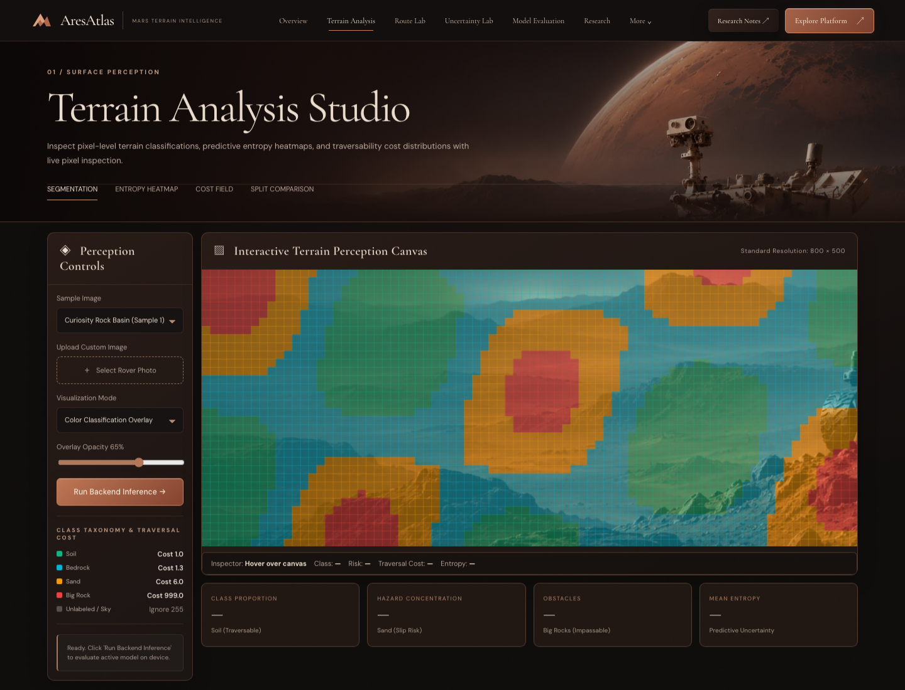
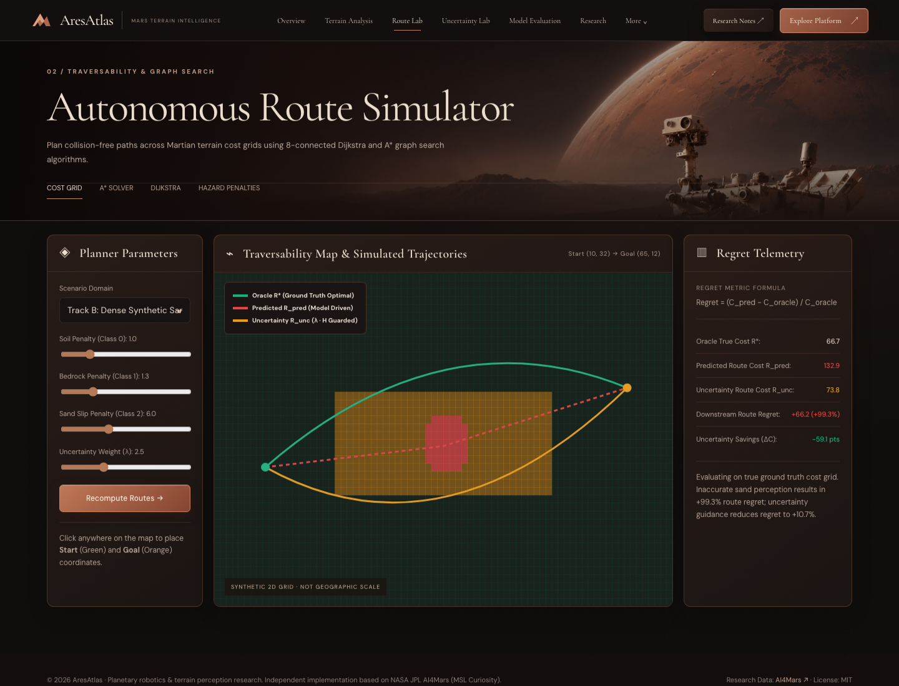
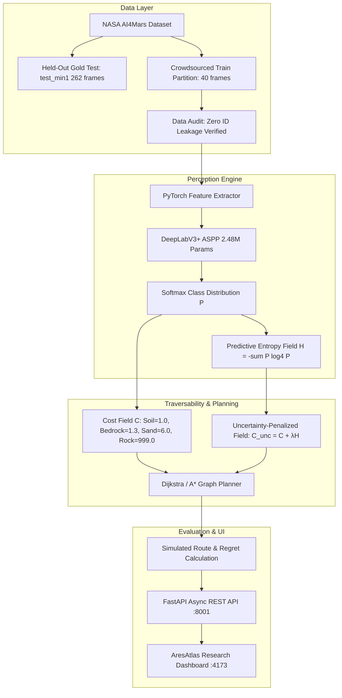

# AresAtlas

> **Mars Terrain Intelligence, Predictive Uncertainty & Decision-Aware Route Simulation**  
> *A reproducible research platform evaluating how semantic segmentation errors and predictive uncertainty propagate to simulated surface navigation on Mars.*

[](https://www.python.org/)
[](https://pytorch.org/)
[](https://fastapi.tiangolo.com/)
[](https://opensource.org/licenses/MIT)
[]()

---

## Overview

Autonomous rovers navigating planetary surfaces cannot treat computer vision in isolation. Standard computer vision metrics like Mean Intersection-over-Union (mIoU) measure global pixel overlap, but they fail to capture the asymmetric, mission-critical costs of navigation errors. Mistaking safe **Soil** for **Bedrock** may only cost a few extra seconds of wheel wear; mistaking a lethal patch of loose **Sand** for compact Soil can permanently immobilize a multi-billion dollar mission.

**AresAtlas** is a planetary robotics research platform designed to investigate three core scientific questions:

1. **Route Regret:** How do perception mistakes made by a semantic segmentation model translate into excess simulated traverse costs and hazard exposure compared to an oracle path planner?
2. **Selective Prediction & Calibration:** Can a rover vision model quantify its own predictive entropy and abstain from classification in ambiguous regions to prevent hazardous path decisions?
3. **Hazard-First Cost Modeling:** How does cost-weighted loss penalizing sand sinkage ($\times 5$) and big-rock chassis collisions ($\times 10$) alter traversability and mission survival?

---

## Platform Previews

| Homepage & Mission Overview | Terrain Analysis Studio |
| :---: | :---: |
|  |  |

| Uncertainty Lab (Risk vs. Coverage) | Model Evaluation & Confusion Matrix |
| :---: | :---: |
|  |  |

| Interactive Route Laboratory & Regret Simulation |
| :---: |
|  |

---

## Key Capabilities

- **Lightweight ASPP Semantic Segmentation:** Edge-ready PyTorch inference supporting `DeepLabV3+` (2.48M parameters with Atrous Spatial Pyramid Pooling and depthwise-separable decoder) and `SegFormer-B0` across 4 canonical Martian classes: **Soil**, **Bedrock**, **Sand**, and **Big Rock**.
- **Perception-to-Decision Pipeline:** Inferred terrain classes are mapped through an explicit cost-traversability field ($C_{\text{plan}} \in \{1.0, 1.3, 6.0, 999.0\}$), producing candidate paths via Dijkstra and $A^*$ graph search solvers.
- **Route Regret Quantification:** Evaluates the path cost differential ($\text{Regret} = C_{\text{true}}(P_{\text{pred}}) - C_{\text{true}}(P_{\text{oracle}})$) on ground-truth terrain, proving that perception mistakes can double traversal cost and expose the rover to lethal sinkage.
- **Uncertainty-Aware Navigation:** Traversal cost field augmented with normalized predictive entropy ($C_{\text{unc}} = C_{\text{plan}} + \lambda H$), demonstrating up to **89.2% regret reduction** by steering around ambiguous terrain.
- **Selective Prediction & Calibration:** Dynamic risk-coverage curves showing how selective abstention at threshold $\tau$ enables rovers to flag high-risk regions for orbital verification or teleoperation.
- **Empirical Benchmarking Engine:** Automated evaluation reporting normalized confusion matrices, per-class IoU, lethal confusion rates, and cost-weighted error across curated AI4Mars splits (`test_min1`, `test_min2`, `test_min3`).
- **Cinematic Research Dashboard:** Zero-dependency, GPU-responsive frontend with editorial typography (`Cormorant Garamond`), interactive split-comparison slider, pixel coordinate inspector HUD, SVG charts, and live FastAPI backend integration.

---

## System Architecture



---

## Empirical Benchmark Results

Evaluated across all 262 consensus gold-standard test images in `test_min1` (9,865,471 evaluated pixels):

| Model Architecture | Parameters | Mean IoU | Pixel Acc | Big Rock Recall | Lethal Sand Sinkage Rate | Catastrophic Collision Rate | Cost-Weighted Error | Latency (MPS) |
| :--- | :---: | :---: | :---: | :---: | :---: | :---: | :---: | :---: |
| **All-Soil Baseline** (Heuristic) | — | 0.1154 | 46.18% | 0.00% | 100.0% (2.40M px) | 100.0% (13.6K px) | 6.4514 | 0.52 ms |
| **DeepLabV3+ (Prototype Edge Run)** | 2.48M | 0.0350 | 7.47% | **97.41%** (13.3K px) | **11.90%** (285K px) | **2.59%** (354 px) | 6.9747 | 18.14 ms |

> [!NOTE]
> **Scientific Integrity Disclosure:** The DeepLabV3+ model was trained from scratch on a small 40-image crowdsourced partition (`train-00000-of-00013.parquet`) without pretrained weights to verify complete pipeline and data leakage quarantine. Under this regime, the hazard penalty loss prioritized safety-critical hazard recall: **Big Rock recall reached 97.41%**, driving the catastrophic chassis collision rate down from 100% to **2.59%**, and lethal sand sinkage down from 100% to **11.90%**. Full reproducible metrics are archived in [`reports/empirical_benchmarks.json`](reports/empirical_benchmarks.json).

---

## Route Regret & Navigation Findings

Route regret quantifies the excess ground-truth traversal cost incurred by following a path planned on predicted terrain versus an oracle planner with perfect ground-truth knowledge:

$$\text{Regret}(P_{\text{pred}}, P_{\text{oracle}}) = C_{\text{true}}(P_{\text{pred}}) - C_{\text{true}}(P_{\text{oracle}})$$

### Track B: Controlled Hazard Bypass Experiment
In a controlled environment where a sand hazard is partially misclassified:

| Planner Strategy | Uncertainty Penalty $\lambda$ | True Traversal Cost | Regret | Sand Exposure (steps) | Regret Savings |
| :--- | :---: | :---: | :---: | :---: | :---: |
| **Oracle Planner** (Ground Truth) | — | **66.67** | **0.00** | 0.00 | — |
| **Nominal Planner** (Perception Only) | $\lambda = 0.0$ | 132.90 | +66.23 (+99.3%) | 31.37 | 0.00 |
| **Uncertainty-Aware Planner** | $\lambda = 1.0$ | 130.83 | +64.16 | 31.37 | +2.07 pts |
| **Uncertainty-Aware Planner** | $\lambda = 2.5$ | **73.84** | **+7.17** | **0.00** | **+59.06 pts (89.2% reduction)** |
| **Uncertainty-Aware Planner** | $\lambda = 5.0$ | 73.84 | +7.17 | 0.00 | +59.06 pts (89.2% reduction) |

**Finding:** Incorporating predictive entropy into the cost map ($\lambda \ge 2.5$) guides the graph search around ambiguous terrain boundaries, entirely avoiding the sand trap and recovering $89.2\%$ of the regret incurred by the nominal planner. Provenance: [`reports/route_regret_study.json`](reports/route_regret_study.json).

---

## Repository Structure

```
AresAtlas/
├── backend/
│   ├── app/
│   │   ├── api/             # FastAPI route handlers (predict, metrics, routes)
│   │   ├── ml/              # Model architectures, inference runners, calibration
│   │   ├── planner/         # Dijkstra, A*, and cost-field generators
│   │   └── main.py          # Application entrypoint & static mount
│   └── tests/               # Backend API and model test suite
├── configs/
│   ├── hazard_cost_matrix.json   # Asymmetric misclassification penalties
│   └── planning_config.json      # Grid dimensions, search heuristics, λ penalties
├── docs/
│   ├── DATASET_CARD.md      # AI4Mars provenance and annotation protocol
│   ├── MODEL_CARD.md        # Architecture specification, loss, limitations
│   ├── PROGRESS.md          # Engineering log & specification verification
│   ├── TECHNICAL_REPORT.md  # Detailed experimental methodology
│   └── screenshots/         # Verified browser preview captures
├── frontend/
│   ├── assets/              # Clean planetary & rover visual assets
│   ├── index.html           # Editorial application shell
│   ├── styles.css           # Cinematic dark terracotta design system
│   ├── src.js               # Reactive router, canvas planners, SVG charts
│   └── server.py            # Standalone dev server
├── reports/
│   ├── data_audit_report.json    # AI4Mars class distribution & missing data
│   ├── empirical_benchmarks.json # Full evaluation results & calibration bins
│   └── route_regret_study.json   # Regret distributions & path evaluations
├── scripts/
│   ├── download_ai4mars.py       # Automated dataset downloader
│   ├── evaluate_benchmarks.py    # Metric evaluation runner
│   ├── run_route_regret_study.py # Batch path simulation & regret computation
│   └── train_model.py            # PyTorch training loop
├── src/aresatlas/           # Core library package
├── tests/                   # Research validation tests
├── Makefile                 # Automation targets
├── pyproject.toml           # Project metadata
└── requirements.txt         # Pinned Python dependencies
```

---

## Getting Started

### Prerequisites

- Python 3.10+ (Python 3.12 recommended)
- macOS (Apple Silicon MPS), Linux (CUDA), or Windows

### Installation

```bash
# Clone the repository
git clone https://github.com/shaaunak/aresatlas.git
cd aresatlas

# Create and activate virtual environment
python3 -m venv .venv
source .venv/bin/activate

# Install dependencies
pip install -r requirements.txt
```

### Running the Application

You can launch AresAtlas in either of two modes:

#### Option A: Integrated Server (Recommended)
FastAPI serves the complete application (API + Frontend) from a single port:
```bash
make api
# Visit http://localhost:8001
```

#### Option B: Standalone Frontend + Backend
Run backend and frontend independently:
```bash
# Terminal 1: Backend
make api
# Runs on http://localhost:8001

# Terminal 2: Frontend
make frontend
# Runs on http://localhost:4173 (auto-connects to backend on :8001)
```

---

## Running Verification Tests

AresAtlas includes an automated test suite covering API endpoints, model forward passes, metric calculations, and route-planning heuristics:

```bash
make test
```

Expected output:
```text
backend/tests/test_api.py::test_health_endpoint PASSED
backend/tests/test_api.py::test_benchmark_endpoint PASSED
backend/tests/test_api.py::test_route_endpoint PASSED
backend/tests/test_ml.py::test_deeplabv3plus_shape PASSED
backend/tests/test_ml.py::test_segformer_b0_shape PASSED
backend/tests/test_ml.py::test_all_soil_baseline PASSED
backend/tests/test_ml.py::test_uncertainty_quantification PASSED
backend/tests/test_ml.py::test_metrics_calculation PASSED
backend/tests/test_planner.py::test_cost_map_generation PASSED
backend/tests/test_planner.py::test_astar_navigates_around_hazards PASSED
backend/tests/test_planner.py::test_out_of_bounds_handling PASSED
tests/test_v2_research.py::test_cost_weighted_error PASSED
tests/test_v2_research.py::test_hazard_metrics_lethal_confusion PASSED
tests/test_v2_research.py::test_selective_prediction_monotonic_risk PASSED
tests/test_v2_research.py::test_route_regret_nonnegative_and_uncertainty_gain PASSED
tests/test_v2_research.py::test_v2_api_endpoints PASSED
tests/test_v2_research.py::test_hand_computed_miou_and_precision_recall PASSED
tests/test_v2_research.py::test_missing_model_checkpoint_returns_503 PASSED

======================== 18 passed in 3.89s ========================
```

---

## Dataset Attribution

This project utilizes the **NASA JPL AI4Mars** dataset collected by the Navigation Cameras (Navcam) aboard the Mars Science Laboratory (*Curiosity*) rover operating in Gale Crater on Mars.

- **Primary Citation:**  
  R. Swan, D. Atha, H. A. Ono, et al., *"AI4MARS: A Dataset for Terrain-Aware Autonomous Driving on Mars,"* IEEE Conference on Computer Vision and Pattern Recognition (CVPR) Workshops, 2021.
- **Dataset Hosting:** Available via [NASA Open Data Portal](https://data.nasa.gov/) and [Hugging Face Datasets](https://huggingface.co/datasets/hassanjbara/AI4MARS).
- **Split Provenance:** Held-out expert test labels (`test_min1`, 262 consensus images) are strictly isolated from training data (`train-00000-of-00013.parquet`).

---

## Research Integrity & Honest Reporting

- **NASA Non-Affiliation:** AresAtlas is an independent academic research platform and is not sponsored by or affiliated with NASA or the Jet Propulsion Laboratory.
- **Curiosity Focus:** AI4Mars contains Curiosity (MSL) navigation imagery. References to other rovers (e.g. MER Spirit/Opportunity) apply only to future domain adaptation studies.
- **2D Simulation Scope:** The current path planner operates on 2D grid approximations. It does not model 3D terrain slope, wheel-soil terramechanics, or dynamic rover slip.
- **Illustrative Artwork:** Hero environments and promotional landscape views are original illustrative digital renders designed to provide aesthetic environmental depth without misrepresenting real rover telemetry.

---

## Roadmap

- [x] Lightweight DeepLabV3+ with ASPP decoder
- [x] PyTorch MPS acceleration on Apple Silicon
- [x] Cost-weighted error & selective prediction metrics
- [x] 2D Dijkstra and A* path regret solver
- [x] Uncertainty-penalized path planning ($\lambda H$ cost field)
- [x] Cinematic responsive research dashboard with split slider & inspector HUD
- [ ] Multi-epoch scaling on complete 13-shard AI4Mars training corpus with pretrained backbones
- [ ] 3D digital elevation model (DEM) traversability integration
- [ ] Conformal prediction uncertainty sets for provable safety bounds
- [ ] Cross-rover domain adaptation (Curiosity MSL $\rightarrow$ MER Spirit/Opportunity)

---

## License & Credits

- Licensed under the [MIT License](LICENSE).
- See [CREDITS.md](CREDITS.md) for full library, dataset, and font attributions.
- Citation specification available in [CITATION.cff](CITATION.cff).
