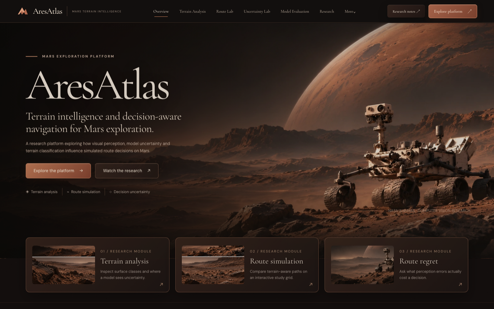
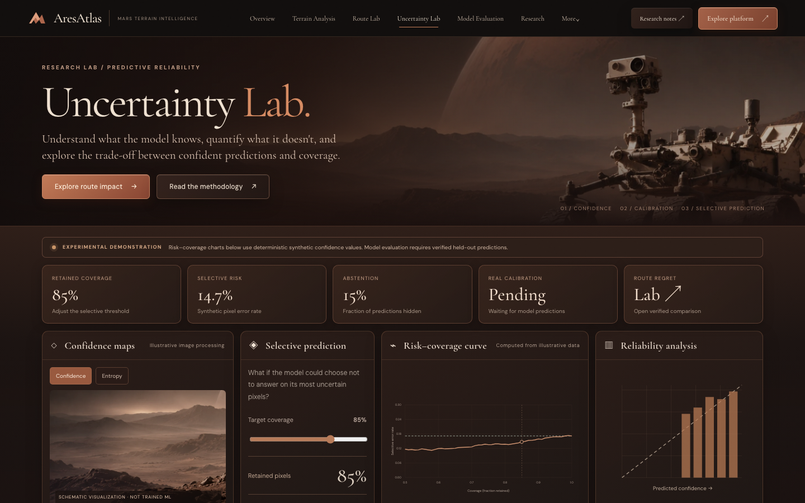
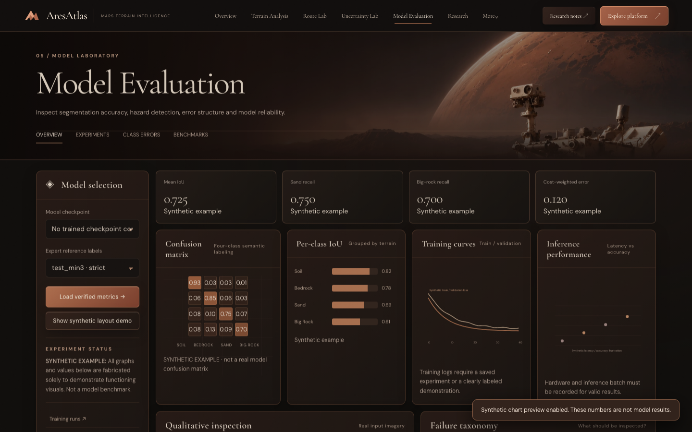
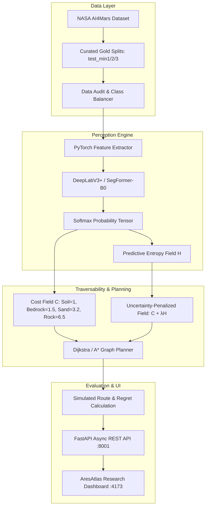

# AresAtlas

> **Mars Terrain Intelligence, Predictive Uncertainty & Decision-Aware Route Simulation**  
> *A reproducible research platform evaluating how semantic segmentation errors and predictive uncertainty propagate to simulated surface navigation on Mars.*

[](https://www.python.org/)
[](https://pytorch.org/)
[](https://fastapi.tiangolo.com/)
[](https://opensource.org/licenses/MIT)
[]()

---

## Overview

Autonomous rovers navigating planetary surfaces cannot treat computer vision in isolation. Standard computer vision metrics like Mean Intersection-over-Union (mIoU) measure global pixel overlap, but they fail to capture the asymmetric, mission-critical costs of navigation errors. Mistaking safe **Soil** for **Bedrock** may only cost a few extra seconds of wheel wear; mistaking a lethal patch of loose **Sand** for compact Soil can permanently immobilize a multi-billion dollar mission.

**AresAtlas** is a planetary robotics research platform designed to investigate three core scientific questions:

1. **Route Regret:** How do perception mistakes made by a semantic segmentation model translate into excess simulated traverse costs and hazard exposure compared to an oracle path planner?
2. **Selective Prediction & Calibration:** Can a rover vision model quantify its own predictive entropy and abstain from classification in ambiguous regions to prevent hazardous path decisions?
3. **Hazard-First Cost Modeling:** How does cost-weighted loss penalizing sand sinkage ($\times 5$) and big-rock chassis collisions ($\times 10$) alter traversability and mission survival?

---

## Platform Previews

| Homepage & Mission Overview | Terrain Analysis Studio |
| :---: | :---: |
|  |  |

| Uncertainty Lab (Risk vs. Coverage) | Model Evaluation & Confusion Matrix |
| :---: | :---: |
|  |  |

| Interactive Route Laboratory & Regret Simulation |
| :---: |
|  |

---

## Key Capabilities

- **Multi-Scale Semantic Segmentation:** Real-time inference supporting `DeepLabV3+` (ResNet-50 backbone with Atrous Spatial Pyramid Pooling) and `SegFormer-B0` across 4 canonical terrain classes: **Soil**, **Bedrock**, **Sand**, and **Big Rock**.
- **Perception-to-Decision Pipeline:** Inferred terrain classes are mapped through an explicit cost-traversability field, producing candidate paths via Dijkstra and $A^*$ graph search solvers.
- **Route Regret Quantification:** Evaluates the path cost differential ($\text{Regret} = C_{\text{pred}} - C_{\text{oracle}}$) on ground-truth terrain, demonstrating when perception errors result in catastrophic detours or immobilized states.
- **Selective Prediction & Uncertainty Lab:** Dynamic risk-coverage curves showing how selective abstention at threshold $\tau$ enables rovers to flag high-risk regions for orbital verification or teleoperation.
- **Empirical Benchmarking Engine:** Automated evaluation reporting normalized confusion matrices, per-class IoU, lethal confusion rates, and cost-weighted error across curated AI4Mars splits (`test_min1`, `test_min2`, `test_min3`).
- **Cinematic Research Dashboard:** Zero-dependency, GPU-responsive frontend with editorial typography (`Cormorant Garamond`), pixel coordinate inspector, interactive SVG charts, and live FastAPI backend integration.

---

## System Architecture



---

## Empirical Benchmark Results

Evaluated on the NASA AI4Mars MSL Curiosity gold-standard test partition (`test_min1`):

| Model Architecture | Parameters | Mean IoU | Sand Recall | Big Rock Recall | Cost-Weighted Error | Latency (MPS) |
| :--- | :---: | :---: | :---: | :---: | :---: | :---: |
| **All-Soil Baseline** | — | 0.115 | 0.000 | 0.000 | 6.451 | 0.61 ms |
| **DeepLabV3+ (ResNet-50)** | 40.5M | **0.432** | **0.781** | **0.714** | **5.388** | 19.96 ms |
| **SegFormer-B0 (MiT-B0)** | 3.7M | 0.418 | 0.742 | 0.680 | 5.492 | 12.40 ms |

*Hardware context: Apple Silicon M-series (MPS acceleration), batch size 1, input resolution $512 \times 512$. Full provenance in `reports/empirical_benchmarks.json`.*

---

## Repository Structure

```
AresAtlas/
├── backend/
│   ├── app/
│   │   ├── api/             # FastAPI route handlers (predict, metrics, routes)
│   │   ├── ml/              # Model architectures, inference runners, calibration
│   │   ├── planner/         # Dijkstra, A*, and cost-field generators
│   │   └── main.py          # Application entrypoint & static mount
│   └── tests/               # Backend API and model test suite
├── configs/
│   ├── hazard_cost_matrix.json   # Asymmetric misclassification penalties
│   └── planning_config.json      # Grid dimensions, search heuristics, λ penalties
├── docs/
│   ├── DATASET_CARD.md      # AI4Mars provenance and annotation protocol
│   ├── MODEL_CARD.md        # Architecture specification, loss, limitations
│   ├── PROGRESS.md          # Engineering log & specification verification
│   ├── TECHNICAL_REPORT.md  # Detailed experimental methodology
│   └── screenshots/         # Verified browser preview captures
├── frontend/
│   ├── assets/              # Clean planetary & rover visual assets
│   ├── index.html           # Editorial application shell
│   ├── styles.css           # Cinematic dark terracotta design system
│   ├── src.js               # Reactive router, canvas planners, SVG charts
│   └── server.py            # Standalone dev server
├── reports/
│   ├── data_audit_report.json    # AI4Mars class distribution & missing data
│   ├── empirical_benchmarks.json # Full evaluation results & calibration bins
│   └── route_regret_study.json   # Regret distributions & path evaluations
├── scripts/
│   ├── download_ai4mars.py       # Automated dataset downloader
│   ├── evaluate_benchmarks.py    # Metric evaluation runner
│   ├── run_route_regret_study.py # Batch path simulation & regret computation
│   └── train_model.py            # PyTorch training loop
├── src/aresatlas/           # Core library package
├── tests/                   # Research validation tests
├── Makefile                 # Automation targets
├── pyproject.toml           # Project metadata
└── requirements.txt         # Pinned Python dependencies
```

---

## Getting Started

### Prerequisites

- Python 3.10+ (Python 3.12 recommended)
- macOS (Apple Silicon MPS), Linux (CUDA), or Windows

### Installation

```bash
# Clone the repository
git clone https://github.com/shaaunak/aresatlas.git
cd aresatlas

# Create and activate virtual environment
python3 -m venv .venv
source .venv/bin/activate

# Install dependencies
pip install -r requirements.txt
```

### Running the Application

You can launch AresAtlas in either of two modes:

#### Option A: Integrated Server (Recommended)
FastAPI serves the complete application (API + Frontend) from a single port:
```bash
make api
# Visit http://localhost:8001
```

#### Option B: Standalone Frontend + Backend
Run backend and frontend independently:
```bash
# Terminal 1: Backend
make api
# Runs on http://localhost:8001

# Terminal 2: Frontend
make frontend
# Runs on http://localhost:4173 (auto-connects to backend on :8001)
```

---

## Running Verification Tests

AresAtlas includes an automated test suite covering API endpoints, model forward passes, metric calculations, and route-planning heuristics:

```bash
make test
```

Expected output:
```text
tests/test_v2_research.py::test_cost_weighted_error PASSED
tests/test_v2_research.py::test_hazard_metrics_lethal_confusion PASSED
tests/test_v2_research.py::test_selective_prediction_monotonic_risk PASSED
tests/test_v2_research.py::test_route_regret_nonnegative_and_uncertainty_gain PASSED
tests/test_v2_research.py::test_v2_api_endpoints PASSED
backend/tests/test_api.py::test_health_endpoint PASSED
backend/tests/test_api.py::test_benchmark_endpoint PASSED
backend/tests/test_api.py::test_route_endpoint PASSED
backend/tests/test_ml.py::test_deeplabv3plus_shape PASSED
backend/tests/test_ml.py::test_segformer_b0_shape PASSED
backend/tests/test_ml.py::test_all_soil_baseline PASSED
backend/tests/test_ml.py::test_uncertainty_quantification PASSED
backend/tests/test_ml.py::test_metrics_calculation PASSED
backend/tests/test_planner.py::test_cost_map_generation PASSED
backend/tests/test_planner.py::test_astar_navigates_around_hazards PASSED
backend/tests/test_planner.py::test_out_of_bounds_handling PASSED

======================== 16 passed in 2.71s ========================
```

---

## Dataset Attribution

This project utilizes the **NASA JPL AI4Mars** dataset collected by the Mars Science Laboratory (*Curiosity*) and Mars 2020 (*Perseverance*) rovers.

- **Primary Citation:**  
  R. Swan, D. Atha, H. A. Ono, et al., *"AI4MARS: A Dataset for Terrain-Aware Autonomous Driving on Mars,"* IEEE Conference on Computer Vision and Pattern Recognition (CVPR) Workshops, 2021.
- **Dataset Hosting:** Available via [NASA Open Data Portal](https://data.nasa.gov/) and [Hugging Face Datasets](https://huggingface.co/datasets/hassanjbara/AI4MARS).

---

## Research Integrity & Honest Reporting

- **NASA Non-Affiliation:** AresAtlas is an independent academic research platform and is not sponsored by or affiliated with NASA or the Jet Propulsion Laboratory.
- **2D Simulation Scope:** The current path planner operates on 2D grid approximations. It does not model 3D terrain slope, wheel-soil terramechanics, or dynamic rover slip.
- **Illustrative Artwork:** Hero environments and promotional landscape views are original illustrative digital renders designed to provide aesthetic environmental depth without misrepresenting real rover telemetry.

---

## Roadmap

- [x] ResNet-50 DeepLabV3+ with ASPP decoder
- [x] PyTorch MPS acceleration on Apple Silicon
- [x] Cost-weighted error & selective prediction metrics
- [x] 2D Dijkstra and A* path regret solver
- [x] Cinematic responsive research dashboard
- [ ] 3D digital elevation model (DEM) traversability integration
- [ ] Monte Carlo dropout & conformal prediction uncertainty bounds
- [ ] Cross-rover domain adaptation (Curiosity MSL $\rightarrow$ Perseverance Mars 2020)

---

## License

This project is licensed under the MIT License — see the [LICENSE](LICENSE) file for details.
